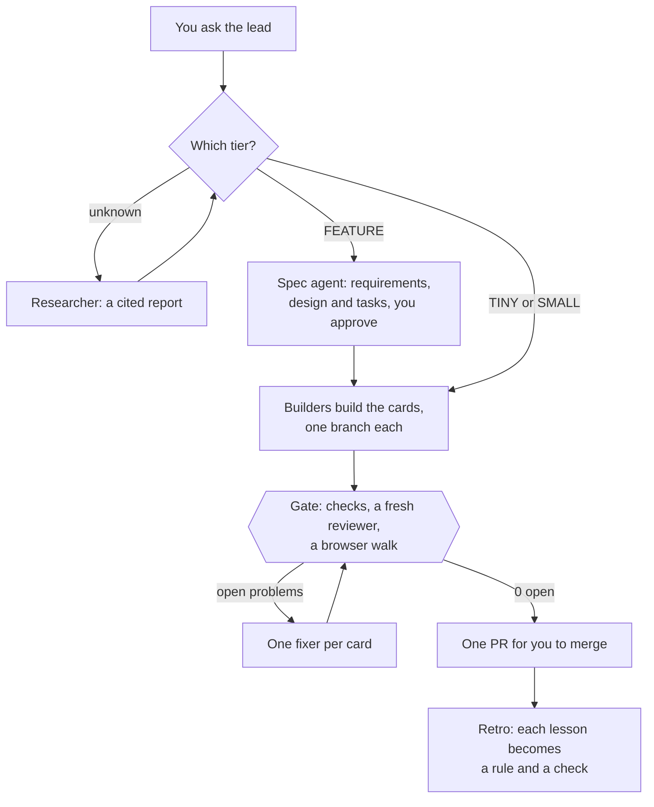

# Puffin Colony

[](https://github.com/puffin-ai/puffin-colony/actions/workflows/tests.yml)
[](LICENSE)
[](pyproject.toml)

**A team of Claude Code agents for your repo: you say what you want, they plan, build, check, and hand you one pull request.**

## What happens, in 30 seconds

1. You open your repo in Claude Code and say what you want, in plain words: "Add a dark mode switch, and fix the date picker on phones."
2. Your **lead**, the session you talk to, splits the request into **cards** on a GitHub board and asks you only what it can't decide, each time with a default.
3. **Helpers** take the cards and build them at the same time, each on its own branch and in its own part of the code.
4. Colony checks the work: your tests, a fresh **reviewer** that reads the change, and, for a web app, a **walker** that clicks through it in a browser. Each problem goes back to the helper that made it, for up to 3 rounds; what is still open after that becomes a new card.
5. The lead hands you **one pull request**. You read it and merge.

What the agents learn stays in your repo as pages, not in a chat that ends. [Explained simply](docs/explained-simply.md) says a bit more about each part.

## Quick start

You need [Claude Code](https://code.claude.com) (signed in), `git`, and the GitHub CLI `gh` (signed in). Your repo must be on GitHub.

**In a repo that already runs Colony**, Colony comes with the repo, the way a Next.js app's version comes with its `package.json`: clone it, open it in Claude Code, and log in. There is no plugin, click or command. The repo carries `.colony/bin/colony`, a launcher pinned to one Colony version, and its hooks put that launcher on the session's PATH. The first run fetches the pinned version from GitHub through [uv](https://docs.astral.sh/uv/) and keeps it for later runs. If the computer has no uv, the launcher installs it and says so.

**To try Colony in a repo that doesn't run it yet**, use the plugin:

1. In Claude Code, add the plugin: `/plugin marketplace add puffin-ai/puffin-colony`, then `/plugin install puffin-colony@puffin-colony`.
2. Open your repo in Claude Code.
3. Say **hi**.

The first time, Colony asks which of 3 setups you want, then a few questions, each with a default. It opens one PR with everything it wrote, including the launcher pinned to the version you ran. Merge it, and from then on the repo carries Colony for every teammate. Every time after that, "hi" opens your lead. When a newer Colony is out, the lead says so once a day with a link to what changed, and `colony upgrade` moves the pin on a branch, ready for a PR.

To install by hand instead, and run Colony from your terminal:

```sh
uv tool install git+https://github.com/puffin-ai/puffin-colony
cd your-repo && colony
```

`pipx install git+https://github.com/puffin-ai/puffin-colony` works too. [docs/install.md](docs/install.md) covers the plugin, Windows, and how a repo names Colony for every teammate. Add `--dry-run` to any `colony` command to see a plan without running anything.

## Docs

- [Explained simply](docs/explained-simply.md): the whole system in plain words
- [Overview](docs/overview.md): every part on one page, with diagrams
- [Install](docs/install.md): the plugin, the package, and Windows
- [Modes](docs/modes.md): Hack, Solo and Startup, the defaults files, and switching
- [Hackathon guide](docs/hackathon.md): one page, from kickoff to the demo
- [How it works](docs/how-it-works.md): setup, the lead, builders and the gate, step by step
- [The cycle](docs/cycle.md): tiers, spec, research, the Needs issue, the board, handover, stats and retro
- [The knowledge vault](docs/knowledge.md): page types, how research becomes rules, and the decision log
- [Commands](docs/commands.md) and [Configuration](docs/configuration.md): every command and every key
- [Presets](docs/presets.md), [Messages](docs/messages.md) and [Safety](docs/safety.md)
- [FAQ](docs/faq.md) and [Roadmap](docs/roadmap.md)

## The 3 setups

- **Hack:** a lead for each teammate, one pinned board issue for messages, and a fast check before `colony merge`.
- **Solo:** one lead for one person, with tests and a reviewer on every change.
- **Startup:** a lead for each person, plus the vault, specs, research, a browser walk and a retro.

Every session you type into is a lead, over its own folders when another lead is already working; type `join` instead, and that session becomes a helper of your lead. To switch setups later, change `mode` in `.colony/colony.toml`. See [docs/modes.md](docs/modes.md#switching-later).

## Why Puffin Colony

- **A team, not one helper.** Claude Code plans, builds in parallel, checks its own work, and hands you one PR.
- **You make the decisions, not the chores.** The lead asks you only what it can't decide, each time with a default.
- **Quality is enforced.** Tests, a fresh reviewer and a real browser walk run in a loop of up to 3 rounds, each checking only what changed. A failing test always blocks, and a finding still open becomes a card.
- **Faster and cheaper over time.** Rules load only when needed, helpers build many cards at once, subagents split each card into pieces that run at the same time, and every minute and dollar is measured.
- **Knowledge stays.** Research, specs and decisions live as pages in your repo, not in a chat that ends.
- **Nothing new to run.** No servers, standard-library Python, on your own machine and your own Claude accounts.

## Modes

The 3 setups are the 3 modes. Setup's first question picks one. It is `mode` in `[project]`, and a config without one is `startup`.

| | Hack | Solo | Startup |
| --- | --- | --- | --- |
| For | A team, for hours or a weekend | One person, a small project | A company's whole life cycle |
| Leads | One per person, as peers | One | One per person, with a digest |
| Messages | One pinned board issue, with `@login` and `@all` | Lines on cards | Lines on cards, the coordination issue, the digest |
| Gate | The fast check, then `colony merge <branch>` | The checks and a reviewer | The checks, a reviewer and a browser walk, up to 3 rounds |
| Vault, specs, research, retro | No | Off, can be turned on | Yes |

More in [docs/modes.md](docs/modes.md).

## A hackathon in 60 seconds

1. **Install** Colony on every teammate's machine, with the install command above.
2. **One person runs `colony`**, picks `hack`, and answers the team, who owns which folders, and the demo time. Merge the setup PR.
3. **Each teammate pulls and runs `colony`** on their own machine, and gets a lead for their folders.
4. **Agents post on the pinned board issue**, and `@login` reaches that person's lead. `@all` reaches everyone.
5. **`colony merge <branch>`** merges into the base after the fast check passes, and opens a PR otherwise.

The one-page guide, with kickoff, the board, Codex, your phone and the last hour: [docs/hackathon.md](docs/hackathon.md).

## How Startup works



**What you do:** talk to the lead in plain words, answer what it can't decide, and merge. Setup also adds:

- **A knowledge vault**, `knowledge/`, of typed pages with `[[links]]` that Obsidian reads, checked by `colony check-docs`. See [docs/knowledge.md](docs/knowledge.md).
- **Rules in three levels**, from a short core in every session to full rules on demand, from the `lean` or `puffin` preset or your own. See [docs/presets.md](docs/presets.md).
- **A board and a Needs issue.** Cards live on a GitHub Project, and the decisions only you make go to `Needs <you>`, each with a default. See [docs/cycle.md](docs/cycle.md).
- **Guards.** A wait guard, hooks that tell the lead when a builder is stuck, and a ledger that fails when lint suppressions grow. Colony never pushes to your base branch, except `colony merge` in Hack. See [docs/safety.md](docs/safety.md).
- **Messages.** Agents talk in one-line issue comments: on the card, on the coordination issue between leads, or on your Needs issue. See [docs/messages.md](docs/messages.md).

## Numbers from the first batch

One team's first batch: Puffin Calendar, on 2026-11-05. It is one run, not a benchmark, and your numbers will differ.

| What | Result |
| --- | --- |
| Open problems across 10 cards | 7 → 0, over 4 fix rounds |
| Phone bugs the browser walk caught that tests missed | 4 |
| Time per fix card | 1 to 25 minutes, median about 5 |
| A tiny change | about 2 minutes |
| The whole batch | about 2.5 hours, mostly checks |
| Cost per session after rules loaded only when needed | 14% lower |

Colony's first batch with nobody relaying messages, and what it cost, are in [docs/faq.md](docs/faq.md#numbers-from-the-first-batches).

## Develop

```sh
uv run --with pytest pytest -q tests
```

Colony is Python 3.11+ standard library only, and shells out to `git`, `gh`, `claude` and `cmux`. [CONTRIBUTING.md](CONTRIBUTING.md) says how to send a change, and [SECURITY.md](SECURITY.md) how to report a security problem.
