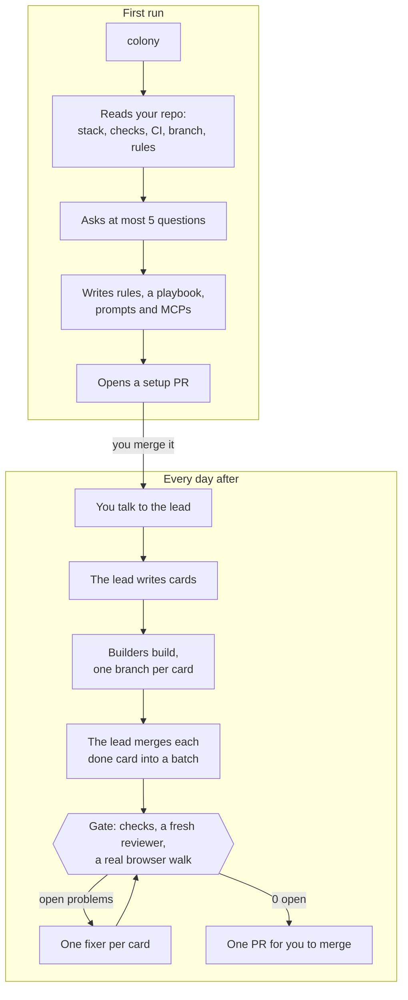

# Puffin Colony

**One command, and Claude Code runs your repo's whole software life cycle.**

You talk to a lead agent. It writes the tasks, runs builders, checks their work until nothing is left to fix, and hands you one pull request to merge.

```console
$ cd your-repo && colony     # first time: at most 5 questions, then a setup PR
$ colony                     # every day after: your lead opens
> Add a dark mode switch to settings, and fix the date picker on phones.
```

## Quick start

You need Python 3.11 or later, `git`, the GitHub CLI `gh` (signed in), and [Claude Code](https://code.claude.com) (signed in). Your repo must be on GitHub.

```sh
uv tool install git+https://github.com/Puffin-Calendar/puffin-colony
cd your-repo && colony
```

> The repo may be private for now. If the install can't clone it, ask for access, then run `gh auth setup-git` so git uses your GitHub login. `pipx install git+https://github.com/Puffin-Calendar/puffin-colony` works too.

The first `colony` reads your repo and asks at most 5 questions. Each one has a default, so "defaults" is a full answer. Then it opens a setup PR. Merge it, run `colony` again, and tell your lead what you want.

Add `--dry-run` to see the plan without running anything. It prints the command and the names of the env variables it would set, never their values.

## How it works



**The first run** reads your stack, your test, lint and typecheck commands, your CI files, your default branch, and any `CLAUDE.md` or `AGENTS.md`. It asks who is on the team, which branch PRs go to, which rules to use, any spend limit, and anything agents must never do. Then it commits `.colony/` (rules, a playbook, and your settings), the role prompts and the MCPs you accept, as one PR.

**Every day after**, `colony` opens your lead. The lead:

- turns your request into cards, which are GitHub issues with up to 3 done-when results and the folders they touch;
- opens builders on this machine, up to 4 by default, and prints `colony join <name>` for more on other machines;
- merges each finished card into the batch as it lands, so conflicts show early;
- every 3 to 5 cards, runs the gate: the full checks, a fresh reviewer and a browser walk at desktop and phone width, in parallel. Each problem goes to a fixer for the card that caused it, and the loop repeats until 0 problems are open;
- opens one PR that shows open problems by round (such as 7 → 4 → 1 → 0), the check results, any removed tests, and the minutes each step took.

The lead is quiet. It reads a digest of builder messages every 10 minutes, acts at once on urgent ones, and can talk to your teammates' leads.

The full life cycle is in [docs/how-it-works.md](docs/how-it-works.md).

### What you do

1. **Talk** to the lead in plain words, as you would to a tech lead.
2. **Answer** what it can't decide: money, secrets, deleting data, new dependencies, and merging. It asks one short question with its own pick as the default, and keeps the other cards moving while it waits.
3. **Merge** the PR.

## Numbers from the first batch

These come from one team's first batch: Puffin Calendar, on 2026-11-05. It is one run, not a benchmark, and your numbers will differ.

| What | Result |
| --- | --- |
| Open problems across 10 cards | 7 → 0, over 4 fix rounds |
| Phone bugs the browser walk caught that tests missed | 4 |
| Time per fix card | 1 to 25 minutes, median about 5 |
| Cost per session after loading rules on demand | 14% less |
| A tiny change | about 2 minutes |
| The whole batch | about 2.5 hours, mostly checks |

## Presets

Setup asks which rules your agents follow. You can edit them any time: they are plain Markdown files in `.colony/rules/`.

| Preset | What you get |
| --- | --- |
| `lean` (default) | Six short rule files: coding, testing, security, performance, accessibility and git, with your paths and commands filled in. |
| `puffin` | Puffin Calendar's full engineering system, minus the product: 12 rule files, a docs guide, and must-lines for each app (Next.js, FastAPI, or generic). |
| `own` | No new rules. Your `CLAUDE.md` and `AGENTS.md` are the rules. |

Your own `CLAUDE.md` and `AGENTS.md` always count, whichever preset you pick. More in [docs/presets.md](docs/presets.md).

## Other machines

The lead runs up to `max_builders` builders on your machine. For more, it prints a line such as:

```sh
colony join builder-5
```

Paste it in a clone of the repo on any computer that has Colony and Claude Code. The first time, it tells you what is missing: the clone, the `claude` login, or `gh auth`.

## Cost and safety

- **It never pushes to your base branch.** It pushes only its own branches, and every merge into the base is yours.
- **It spends no model money without your yes.** Agents run on your Claude Code login. The reviewer, walker and fixers run with `ANTHROPIC_API_KEY` removed, so they never bill an API key. While `provider_dollars` is 0, your own checks also run without `ANTHROPIC_API_KEY` and `OPENAI_API_KEY`.
- **It never prints env values.** A dry run shows the names only.
- **It asks before** it spends money, touches a secret, deletes data, adds a dependency, or merges.
- **It shows its work.** The PR lists any removed tests and every step's minutes and cost.

Agents still run commands in your repo. The reviewer, walker and fixers run headless in their own worktrees with Claude Code's auto permission mode. Read [docs/safety.md](docs/safety.md) before your first batch.

## How it compares

Colony is narrower than most of these. It sets up the whole loop in your repo with one command. It keeps every task and message on GitHub issues, so builders on other machines and other people's leads can join. And it doesn't open the PR until checks, a fresh reviewer and a real browser walk agree that 0 problems are open.

Each of these does something better:

| Project | What it is | What it does better |
| --- | --- | --- |
| [Claude Code agent teams](https://code.claude.com/docs/en/agent-teams) | Built into Claude Code, experimental. A lead session spawns teammates that share a task list. | Nothing to install. Messages arrive at once, teammates talk to each other directly, and you can talk to any teammate. |
| [metaswarm](https://github.com/dsifry/metaswarm) | 18 agent personas in a 9-phase flow from issue to merged PR. | A different model reviews each change, coverage gates block the PR, and a design review comes before code. Runs on Gemini CLI and Codex too. |
| [Gas Town](https://github.com/steveyegge/gastown) | A workspace manager where a Mayor agent coordinates many workers. | Built for 20 to 30 agents at once, with a merge queue and git-backed work tracking (Beads) that survives restarts. Works with several agent CLIs. |
| [Compound Engineering](https://github.com/EveryInc/compound-engineering-plugin) | Every's plugin: plan, work, review, then compound what you learned. | The compound step turns each lesson into notes the next task reuses. Detailed planning, and it converts to many other coding tools. |
| [gstack](https://github.com/garrytan/gstack) | Garry Tan's role skills: product and design review, engineering review, QA, browse and ship. | Product thinking before code, and you drive each step yourself. A fast browser tool for QA. |
| [Conductor](https://www.conductor.build) | A Mac app that runs Claude Code and Codex in parallel workspaces. | A real interface for watching many agents, reading their diffs and opening PRs. Its cloud option keeps agents running after you close the laptop. |
| [Claude Squad](https://github.com/smtg-ai/claude-squad) | A terminal UI that runs many agents in tmux, each in its own worktree. | Simple, and works with any terminal agent: Claude Code, Codex, Gemini or Aider. You steer every session yourself. |
| [BMAD Method](https://github.com/bmad-code-org/BMAD-METHOD) | An agile method with PM, architect and developer agents and many workflows. | Deep planning documents, a large community, and a process that scales from a small fix to a large project. |
| [Spec Kit](https://github.com/github/spec-kit) | GitHub's toolkit for spec-driven development. | A clear spec-first method that works with many agents, and specs that stay in the repo as the record. |
| [superpowers](https://github.com/obra/superpowers) | Jesse Vincent's skills library: test first, debugging, brainstorming, planning, and subagent work. | Makes one session better at the craft, with a large, tested skill set that works in several tools. |

Several of these combine with Colony. A superpowers skill or a Spec Kit spec can sit under a Colony card.

## FAQ

**Does it need many Claude accounts?**
No. It uses yours. One account runs the lead, the builders and the gate. `colony.toml` can list more than one settings folder, so that each person on a team uses their own account. Spreading one person's work across several seats may conflict with [Anthropic's terms](https://www.anthropic.com/legal), so check them before you do it.

**Which stacks does it support?**
Any repo on GitHub whose checks run from a shell command. Setup reads `package.json`, `pyproject.toml`, `go.mod`, `Cargo.toml`, `Gemfile`, `pom.xml` and your CI files to find them. The gate names failing tests for pytest and for JavaScript runners such as Vitest and Jest, and sums up other failures from the output. The browser walk needs a web UI: set `walk = false` for a library or a service. It runs on macOS and Linux, and uses [cmux](https://github.com/manaflow-ai/cmux) for new workspaces when it is installed.

**How much does it cost?**
Colony itself costs nothing. Its agents run on your Claude Code plan, so a batch uses your plan's usage. Several agents run at once, so a batch uses it faster than one session would. Every step's minutes and the cost Claude Code reports go into the PR, so you can see where it went. Model calls inside your app's own evals stay at $0 unless you raise `provider_dollars`.

**Can I keep my own rules?**
Yes. Pick `own`, and your `CLAUDE.md` and `AGENTS.md` are the rules. With `lean` or `puffin`, your files still count, and the reviewer checks against both. Everything in `.colony/` is yours to edit.

**Can I see what it will do first?**
Yes. `colony --dry-run` prints the setup plan or the lead's command line. `colony batch --dry-run …` prints every branch, command and filled-in prompt of a batch.

**What if a batch gets stuck?**
It stops when the checks fail the same way two rounds in a row, when a fixer commits nothing, when a merge conflicts outside generated files, or after `max_rounds` rounds. It commits its reports first, and the lead turns the cause into a new card.

## Docs

- [How it works](docs/how-it-works.md): the life cycle, step by step
- [Configuration](docs/configuration.md): every key in `colony.toml`
- [Presets](docs/presets.md): `lean`, `puffin` and `own`
- [Messages](docs/messages.md): lines, the digest, and lead to lead
- [Safety](docs/safety.md): what it never does, and what it asks first
- [Roadmap](docs/roadmap.md)
- [Design](docs/design.md): the design the code follows

## Develop

```sh
uv run --with pytest pytest -q tests
```

Colony is Python 3.11+ standard library only, and shells out to `git`, `gh`, `claude` and `cmux`.
