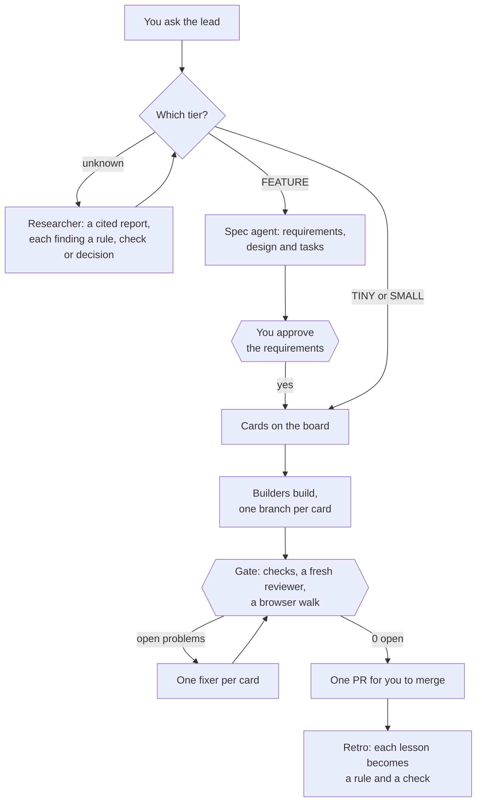

# Puffin Colony

**One command, and Claude Code runs your repo's whole software life cycle: knowledge, plan, research, spec, build, check and learn.**

You talk to a lead agent. It sizes each request, sends a new feature to a spec agent and an open question to a researcher, and runs builders. It checks their work until nothing is left to fix, turns each lesson into a rule, and hands you one pull request to merge.

```console
$ cd your-repo && colony     # first time: a few questions, then a setup PR
$ colony                     # every day after: your lead opens
> Add a dark mode switch to settings, and fix the date picker on phones.
```

## Quick start

You need Python 3.11 or later, `git`, the GitHub CLI `gh` (signed in), and [Claude Code](https://code.claude.com) (signed in). Your repo must be on GitHub.

```sh
uv tool install git+https://github.com/Puffin-Calendar/puffin-colony
cd your-repo && colony
```

> The repo may be private for now. If the install can't clone it, ask for access, then run `gh auth setup-git` so git uses your GitHub login. `pipx install git+https://github.com/Puffin-Calendar/puffin-colony` works too.

The first `colony` reads your repo and asks at most 5 questions, each with a default, so "defaults" is a full answer. It writes the rules and the playbook, adds a knowledge vault, the hooks, a board and instant messages on your yes, and opens one setup PR. Merge it, run `colony` again, and tell your lead what you want. Add `--dry-run` to see a plan without running anything.

## How it works



- **Tiers.** `colony tier` reads a branch's diff and prints TINY, SMALL or FEATURE, with a risk list (auth, payments, migrations, secrets, deletion, public API and more) that the batch's reviewer reads first.
- **Builders.** Up to 4 run on your machine. For more, the lead prints `colony join <name>` to paste on another computer.
- **The gate.** Every 3 to 5 done cards, the lead runs the full checks, a fresh reviewer and a browser walk at desktop and phone width. Each problem goes to a fixer for the card that caused it, until 0 are open.
- **Learning.** The batch's PR shows each card's predicted and actual minutes and tokens. After each batch, `colony retro` turns each lesson into a rule line plus a check, or a decision, in a PR.

**What you do:** talk to the lead in plain words, answer what it can't decide, and merge. The full cycle is in [docs/cycle.md](docs/cycle.md).

## The knowledge vault

Setup makes `knowledge/` at your repo's root, or adopts the docs folder you have. It holds what the team decided, built and found out, as typed pages with `[[links]]` that Obsidian reads.

- **29 page types**, from PRD and decision record to living spec and runbook, defined in `knowledge/.types/`. Every page declares one.
- **Sources, research and decisions stay apart.** `raw/` holds outside material frozen as it arrived. `research/` holds what an investigation concluded, and a report is done only when every finding is a rule, a check, or your decision. A decision record sits in the wiki beside the pages it decides.
- **The decision log**, `knowledge/decisions.md`, lists every decision record by area. `colony check-docs` writes it from the records, so nobody edits it by hand.
- **`colony check-docs`** checks types, links, orphan pages, folder maps, code paths, size caps, copied paragraphs and rule budgets.

More in [docs/knowledge.md](docs/knowledge.md).

## Three rule levels

| Level | Where | Loads |
| --- | --- | --- |
| Core | `.colony/core.md`, imported by `CLAUDE.md` | In every session. Report failure as failure, quote the output behind a success claim, never weaken a check, keep secrets out of output. |
| Area essentials | `AGENTS.md` in each app folder | When an agent opens a file there. Numbered must-lines. |
| Full rules | `.colony/rules/*.md` | On demand. The reviewer's checklist. |

Setup asks for a preset to fill them: `lean` (the default), `puffin` (Puffin Calendar's full engineering system, minus the product), or `own` (your `CLAUDE.md` and `AGENTS.md`). Your own files always count. More in [docs/presets.md](docs/presets.md).

## The board and the Needs-you queue

- **The board** is a GitHub Project, `Colony: <project>`, with each card's Status, Builder, Tier, State, Last update, Account and Branch. Builders set State and Last update, and the lead sets the rest. A card In progress with no update for 2.5 hours gives the lead a `stale:` line.
- **Your Needs issue**, `Needs <you>`, holds the decisions only you make: money, secrets, deleting data, dependencies, a feature's requirements, and merging. The lead posts each one with its default and keeps working on that default. Your reply wins. It tells you in chat only when something is urgent or blocks the work.

## Guards

- **The wait guard** refuses a foreground sleep, poll loop or watch, so no session blocks itself.
- **Two hooks** post a line for the lead when a builder waits on a permission pop-up, or when a turn ends on an error.
- **The suppressions ledger** counts `# noqa`, `eslint-disable`, `@ts-expect-error` and the like in each file, and fails the checks when a count grows.
- **Locks in the code.** Colony never pushes to your base branch, never prints env values, and runs the gate's agents without `ANTHROPIC_API_KEY`, so they never bill an API key.

`colony hooks install` merges the hooks into `.claude/settings.json` and keeps yours. Read [docs/safety.md](docs/safety.md) before your first batch.

## Instant messages

Agents talk in one-line issue comments, `for <name>: <sentence> (from <name>)`. GitHub keeps the record, so a builder on another computer needs only `gh`. With `transport = "relay"` and an Agent Relay core on the machine, a line that can't wait also goes straight into the receiving session, between its turns. The wait skips the copy it reads later, so each line is acted on once. More in [docs/messages.md](docs/messages.md).

## Numbers from the first batch

These come from one team's first batch: Puffin Calendar, on 2026-11-05. It is one run, not a benchmark, and your numbers will differ.

| What | Result |
| --- | --- |
| Open problems across 10 cards | 7 → 0, over 4 fix rounds |
| Phone bugs the browser walk caught that tests missed | 4 |
| Time per fix card | 1 to 25 minutes, median about 5 |
| Cost per session after loading rules on demand | 14% less |
| A tiny change | about 2 minutes |
| The whole batch | about 2.5 hours, mostly checks |

The same day, Colony ran a batch on its own for the first time, with nobody relaying messages ([Puffin PR #1310](https://github.com/Puffin-Calendar/puffin-calendar/pull/1310)):

| What | Result |
| --- | --- |
| Setup on Puffin's repo | 2.6 minutes and $1.00. It wrote the config, playbook, skills and one AGENTS.md row, and opened its own setup PR |
| Two cards, from the job to an open PR | about 66 minutes. The lead opened a builder and handed out the cards. It answered the builder's question on the card in minutes, then ran the gate |
| The gate | open problems 1 → 0 in 2 rounds, with the walk and the checks passing both times |
| Agent cost | $9.58 at API prices: $5.90 walk, $2.38 review, $1.30 fix |

## Docs

- [How it works](docs/how-it-works.md): setup, the lead, builders and the gate, step by step
- [The cycle](docs/cycle.md): tiers, spec, research, the Needs issue, the board, handover, stats and retro
- [The knowledge vault](docs/knowledge.md): page types, how research becomes rules, and the decision log
- [Commands](docs/commands.md): every command, one line each
- [Configuration](docs/configuration.md): every key in `colony.toml`
- [Presets](docs/presets.md): the three rule levels in `lean`, `puffin` and `own`
- [Messages](docs/messages.md): lines, the digest, lead to lead, and the relay
- [Safety](docs/safety.md): the locks, the hooks, and what it asks first
- [FAQ](docs/faq.md): common questions, and how Colony compares
- [Roadmap](docs/roadmap.md)
- [Design](docs/design.md) and [Design 0.2](docs/design-v0.2.md): the designs the code follows

## Develop

```sh
uv run --with pytest pytest -q tests
```

Colony is Python 3.11+ standard library only, and shells out to `git`, `gh`, `claude` and `cmux`.
