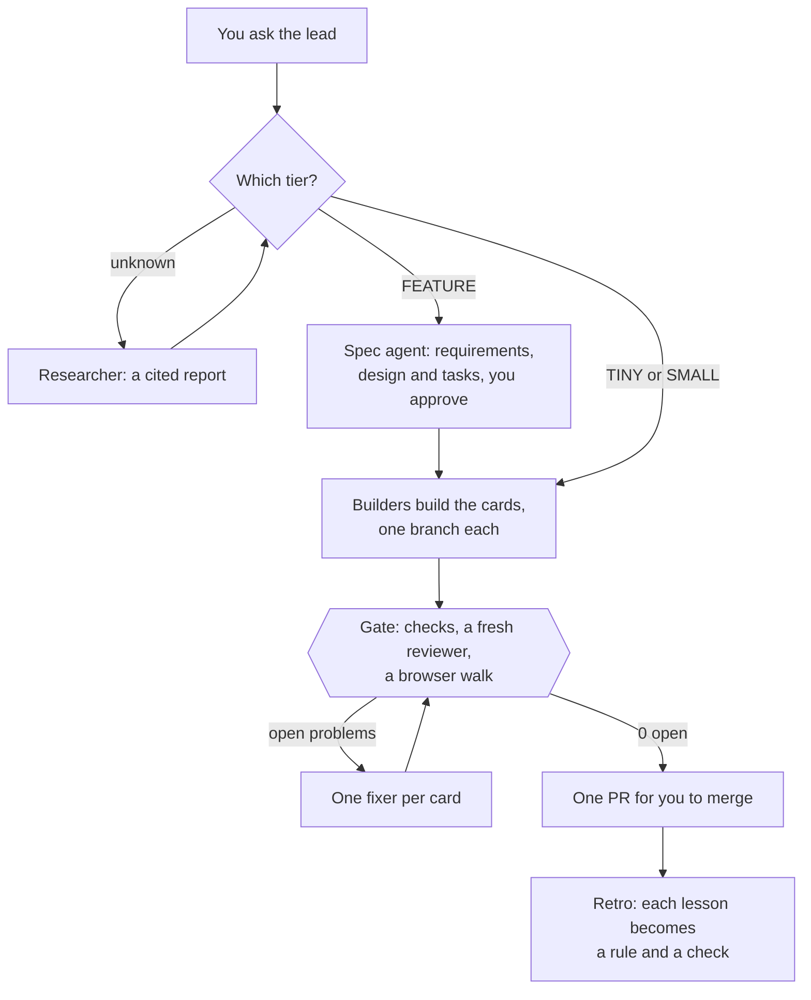

# Puffin Colony

**One command, and Claude Code runs your repo's whole software life cycle: knowledge, plan, research, spec, build, check and learn.**

New here? [Explained like you're five](#explained-like-youre-five) tells the story in a minute. [The full overview](docs/overview.md) covers every part, with diagrams.

## Why Puffin Colony

- **A team, not one helper.** Claude Code plans, builds in parallel, checks its own work, and hands you one PR.
- **You make the decisions, not the chores.** The lead asks you only what it can't decide, each time with a default.
- **Quality is enforced.** Tests, a fresh reviewer and a real browser walk run in a loop until 0 problems are open.
- **Faster and cheaper over time.** Rules load only when needed, helpers work in parallel, and every minute and dollar is measured.
- **Knowledge stays.** Research, specs and decisions live as pages in your repo, not in a chat that ends.
- **Nothing new to run.** One command, no servers, standard-library Python, on your own machine and your own Claude accounts.

What one team saw in its first runs, on 2026-11-05. These are early runs, not a benchmark, and your numbers will differ:

- Open problems went from 7 to 0 over 4 fix rounds, across 10 cards.
- The browser walk caught 4 phone bugs that the tests missed.
- Loading rules only when needed cut the cost per session by 14%.
- A tiny change took about 2 minutes.
- In the second batch, two cards went from the request to an open PR in about 66 minutes, for $9.58 of agent cost at API prices.

## Explained like you're five

You are the boss of a puffin colony. You tell the lead puffin what you want. The lead puffin gives jobs to helper puffins, and each helper has its own corner of the nest. When they finish, a checker puffin and a tester puffin look for mistakes, and send each one back to the puffin who made it. They keep going until there are no mistakes left. Then the lead puffin brings you one finished thing to say yes to.

That is all Colony does. [docs/explained-simply.md](docs/explained-simply.md) maps each puffin to the real thing.

You talk to a lead agent. It sizes each request, sends a new feature to a spec agent and an open question to a researcher, and runs builders. It checks their work until nothing is left to fix, turns each lesson into a rule, and hands you one pull request to merge. For a hackathon or a small project, a lighter mode keeps only what fits.

```console
$ cd your-repo && colony     # first time: a few questions, then a setup PR
$ colony                     # every day after: your lead opens
> Add a dark mode switch to settings, and fix the date picker on phones.
```

## Modes

Setup's first question is the mode. It is `mode` in `[project]`, and a config without one is `startup`.

| | Hack | Solo | Startup |
| --- | --- | --- | --- |
| For | A team, for hours or a weekend | One person, a small project | A company's whole life cycle |
| Leads | One per person, as peers | One | One per person, with a digest |
| Messages | One pinned board issue, with `@login` and `@all` | Lines on cards | Lines on cards, the coordination issue, the digest |
| Gate | The fast check, then `colony merge <branch>` | The checks and a reviewer | The checks, a reviewer and a browser walk, until 0 open |
| Vault, specs, research, retro | No | Off, can be turned on | Yes |

More in [docs/modes.md](docs/modes.md).

## Quick start

You need Python 3.11 or later, `git`, the GitHub CLI `gh` (signed in), and [Claude Code](https://code.claude.com) (signed in). Your repo must be on GitHub.

```sh
uv tool install git+https://github.com/Puffin-Calendar/puffin-colony
cd your-repo && colony
```

`pipx install git+https://github.com/Puffin-Calendar/puffin-colony` works too.

The first `colony` reads your repo, asks a few questions, each with a default, and opens one setup PR. Merge it, run `colony` again, and tell your lead what you want. Add `--dry-run` to see a plan without running anything.

Or just open Claude Code in the repo and say hi. After setup, the line it adds to `CLAUDE.md` runs `colony hi`: your session becomes the lead when none runs, and offers to build or help when one does. Before setup, run `colony skill-install` once, and a session in any repo can set Colony up when you ask.

## A hackathon in 60 seconds

1. **Install** Colony on every teammate's machine, with the command above.
2. **One person runs `colony`**, picks `hack`, and answers the team, who owns which folders, and the demo time. Merge the setup PR.
3. **Each teammate pulls and runs `colony`** on their own machine, and gets a lead for their folders.
4. **Agents post on the pinned board issue**, and `@login` reaches that person's lead. `@all` reaches everyone.
5. **`colony merge <branch>`** merges into the base after the fast check passes, and opens a PR otherwise.

The one-page guide, with kickoff, the board, Codex, your phone and the last hour: [docs/hackathon.md](docs/hackathon.md).

## How Startup works



**What you do:** talk to the lead in plain words, answer what it can't decide, and merge. Setup also adds:

- **A knowledge vault**, `knowledge/`, of typed pages with `[[links]]` that Obsidian reads, checked by `colony check-docs`. See [docs/knowledge.md](docs/knowledge.md).
- **Rules in three levels**, from a short core in every session to full rules on demand, from the `lean` or `puffin` preset or your own. See [docs/presets.md](docs/presets.md).
- **A board and a Needs issue.** Cards live on a GitHub Project, and the decisions only you make go to `Needs <you>`, each with a default. See [docs/cycle.md](docs/cycle.md).
- **Guards.** A wait guard, hooks that tell the lead when a builder is stuck, and a ledger that fails when lint suppressions grow. Colony never pushes to your base branch, except `colony merge` in Hack. See [docs/safety.md](docs/safety.md).
- **Messages.** Agents talk in one-line issue comments, and Agent Relay delivers the urgent ones at once. See [docs/messages.md](docs/messages.md).

## Numbers from the first batch

One team's first batch: Puffin Calendar, on 2026-11-05. It is one run, not a benchmark, and your numbers will differ.

| What | Result |
| --- | --- |
| Open problems across 10 cards | 7 → 0, over 4 fix rounds |
| Phone bugs the browser walk caught that tests missed | 4 |
| Time per fix card | 1 to 25 minutes, median about 5 |
| A tiny change | about 2 minutes |
| The whole batch | about 2.5 hours, mostly checks |

Colony's first batch with nobody relaying messages, and what it cost, are in [docs/faq.md](docs/faq.md#numbers-from-the-first-batches).

## Docs

- [Explained simply](docs/explained-simply.md): the whole system as one short story
- [Overview](docs/overview.md): every part on one page, with diagrams
- [Modes](docs/modes.md): Hack, Solo and Startup, the defaults files, and switching
- [Hackathon guide](docs/hackathon.md): one page, from kickoff to the demo
- [How it works](docs/how-it-works.md): setup, the lead, builders and the gate, step by step
- [The cycle](docs/cycle.md): tiers, spec, research, the Needs issue, the board, handover, stats and retro
- [The knowledge vault](docs/knowledge.md): page types, how research becomes rules, and the decision log
- [Commands](docs/commands.md) and [Configuration](docs/configuration.md): every command and every key
- [Presets](docs/presets.md), [Messages](docs/messages.md) and [Safety](docs/safety.md)
- [FAQ](docs/faq.md) and [Roadmap](docs/roadmap.md)

## Develop

```sh
uv run --with pytest pytest -q tests
```

Colony is Python 3.11+ standard library only, and shells out to `git`, `gh`, `claude` and `cmux`.
