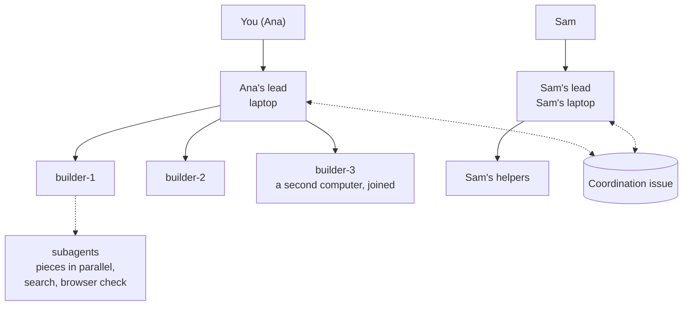
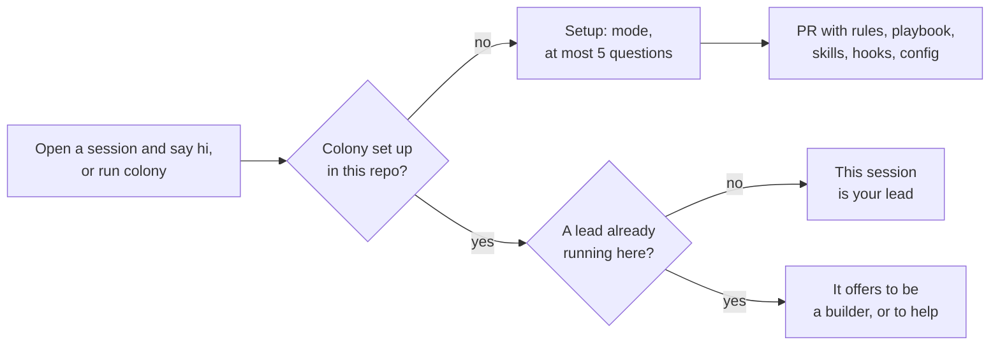
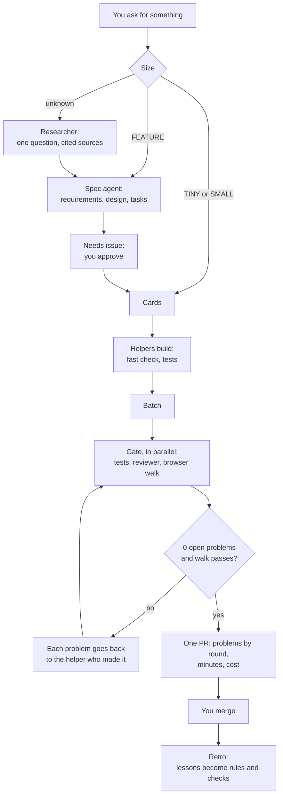
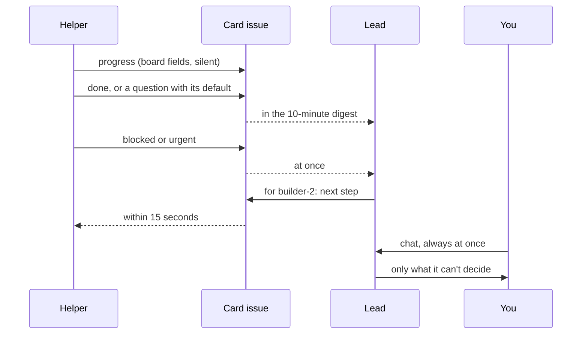
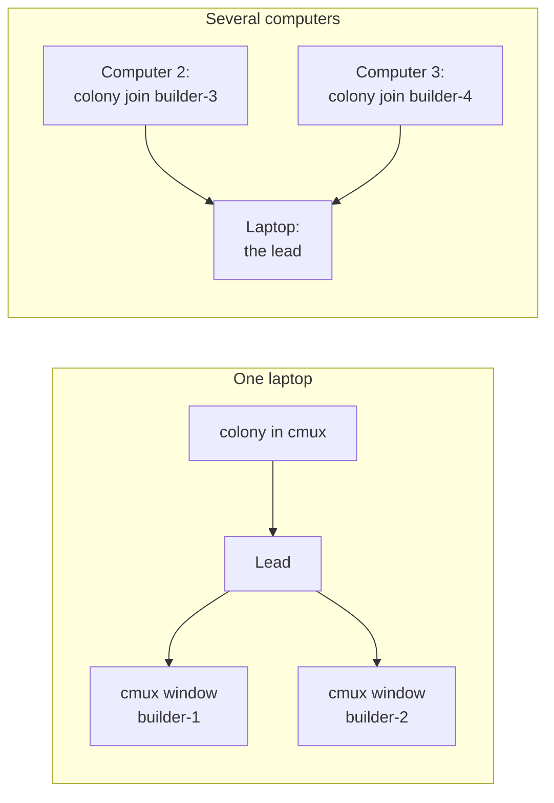
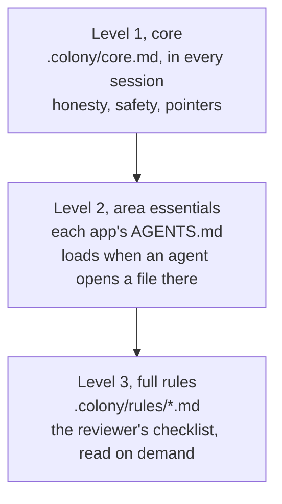
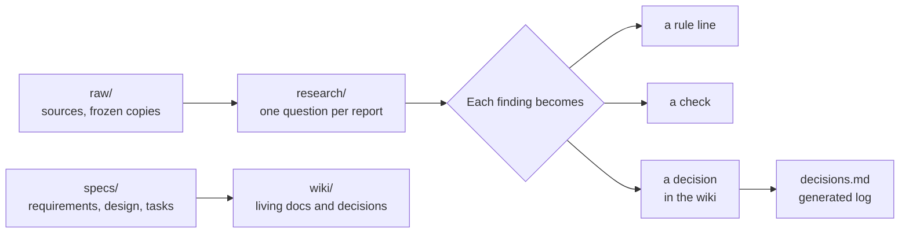

# Overview

Puffin Colony on one page. One command turns Claude Code into your repo's whole software life cycle. You talk to a lead. It plans, builds with helpers, checks everything until nothing is left open, and hands you one pull request to merge.

This page covers each part in short, with diagrams. Each section links to the page with the full detail. For the same system in plain words, read [explained-simply.md](explained-simply.md).

## Who is who

There are three kinds of session:

- **The lead.** The Claude Code session you type into. One per person.
- **Helpers.** Builders, such as `builder-2`, plus the spec agent and the researcher. The lead opens them and gives them work.
- **Subagents.** Short-lived mini-workers a helper starts inside its own session. Many run at the same time, each on one piece of a card, so the card finishes sooner. They also search code and check pages in a browser.

### The four rules

1. **You talk only to leads.** The session you open and type into is your lead. When no lead runs, `colony hi` makes your session the lead. You never chat with a helper.
2. **Each helper belongs to one lead.** It works on that lead's cards, each on its own branch, so its context stays on its job.
3. **Helpers use subagents for speed.** Each subagent does one piece of a card at the same time as the others, and they also search and run browser checks. Subagents return short results, so the helper stays lean. More helpers means more cards at once; more subagents means each card finishes sooner.
4. **Leads talk to leads.** On a team, each person's lead meets the others on one coordination issue. A lead never gives orders to another lead's helpers.



More: [how-it-works.md](how-it-works.md#the-pieces).

## Starting

One command, or no command. The first time, in a repo that has never used Colony, it asks the mode and at most 5 questions. It writes everything into the repo and opens a pull request, so you see what it added. After that it never asks again.



| You want | How |
| --- | --- |
| A lead | Run `colony` in the repo. Or open Claude Code there and say hi: the line setup adds to `CLAUDE.md` runs `colony hi`. |
| Helpers on this computer | Tell the lead, such as "use 2 helpers". It runs `colony open`, which opens cmux windows when cmux is there, and background sessions otherwise. |
| A helper on another computer | The lead prints a `colony join <name>` line. Paste it on that computer. |
| To see the lead | `colony status` prints this computer's lead, its account and its heartbeat age. |

More: [how-it-works.md](how-it-works.md#2-setup-the-first-time).

## Modes

Setup's first question is the mode.

| | Hack | Solo | Startup |
| --- | --- | --- | --- |
| For | A team, for hours or a weekend | One person, a small project | A company's whole life cycle |
| Leads | One per person, as peers | One | One per person |
| Messages | One pinned board issue, with `@login` and `@all` | Lines on cards | Lines on cards, the coordination issue, a digest |
| Checks | The fast check, `colony merge`, and one review before the demo | Tests and a reviewer | Tests, a reviewer and the browser walk, until 0 are open |
| Knowledge, specs, research, card board, retro | Off | Off, each can be turned on | On |

More: [modes.md](modes.md) and [hackathon.md](hackathon.md).

## The life cycle

This is Startup. The lead sizes each request. Small work goes straight to cards. A feature gets a spec you approve. Anything unknown gets researched first.



The reviewer is a fresh session each round. It reads only that round's changes and the list of open problems. Touch and layout work also gets a real browser check by the helper, because tests with a fake browser missed four phone bugs in one team's first batch.

More: [cycle.md](cycle.md) and [how-it-works.md](how-it-works.md).

## Messages

Every session runs the same wait: one cheap GitHub check every 15 seconds. Agents don't open issues to message each other. A message is a one-line comment, `for <name>: <sentence> (from <name>)`, on the card it is about. Each session sees only the lines addressed to it.

| Place on GitHub | Holds | Read by |
| --- | --- | --- |
| One issue per card | The task, and lines about it only | Its lead and its helper |
| The coordination issue | Lines between leads, and handovers | Leads |
| A Needs issue per person | Decisions waiting on you, each with a default | You and your lead |
| The card board | Status only: where each card is, and who has it | Everyone |



When the lead needs to know how a helper's work is going, it reads the helper's branch and card itself. That is instant, and the helper is never interrupted. Where Agent Relay runs, urgent lines also arrive at once.

More: [messages.md](messages.md).

## Machines and accounts

Colony runs on one laptop, or across several computers.



- Each session picks the account with the most room, from the saved 5-hour usage of the accounts in `colony.toml`. `prefer_account` names one to use first, while it is under 90%.
- The lead can't start anything on another computer. It tells you where to go, and you paste one line there.
- The Claude app uses the account it is signed into. A terminal can pick any account on that computer.
- Everything runs on your own machines, with your own Claude accounts.

More: [configuration.md](configuration.md).

## Rules in three levels

Rules load only when they are needed, so each session reads less.



There are three presets. `lean` is short generic rules. `puffin` is a full engineering system for a Next.js app and a Python service. `own` keeps your repo's rules as they are. Your own `CLAUDE.md` and `AGENTS.md` always count. In one team's first batch, loading rules on demand cut the cost per session by 14%.

More: [presets.md](presets.md).

## Knowledge

The vault is `knowledge/` in your repo: typed pages with `[[links]]`, which Obsidian can read.



- There are 29 page types, each with a fixed shape, such as a PRD, a research report, a decision record, a runbook and a threat model.
- `colony check-docs` runs 11 checks: page types, links, orphans, folder maps, code paths that must exist, size caps, copied text, the rule budget, replaced records and the decision log. A repo can add its own checks as plug-ins.
- Ideas go in `future-work.md`, never in issues.

More: [knowledge.md](knowledge.md).

## Guards and anti-bloat

What keeps it safe and small:

| Guard | What it does |
| --- | --- |
| Hooks | Refuse sleeps in the foreground and poll loops. Send the lead an urgent line when a helper waits on a permission pop-up, and a line when a turn ends on an error. Show unread lines when you type. |
| Never | Push to the base branch (except `colony merge` in Hack), spend model money without your yes, print secrets, or weaken a check. |
| Suppressions ledger | Lint and type ignores can only shrink. `colony suppressions` fails when a count grows. |
| Stale cards | A card with no update for 2.5 hours gives the lead a `stale:` line, so a quiet helper gets noticed. |
| Rule budget | Each rule file stays within its size, checked by `colony check-docs`. |
| Stuck batches | A batch stops when the checks fail the same way two rounds in a row, when a fixer commits nothing, or after `max_rounds`. |

More: [safety.md](safety.md).

## Commands

What you type:

```text
colony                  start, or open your lead
colony join <name>      lend this computer to your lead, as a builder
colony status           this computer's lead, account, heartbeat, and the newest batch
colony merge <branch>   Hack only: merge after the fast check passes
```

Everything else, such as `open`, `batch`, `post`, `say`, `research`, `spec`, `needs`, `board` and `check-docs`, the lead runs for you. Every command and flag is in [commands.md](commands.md).
